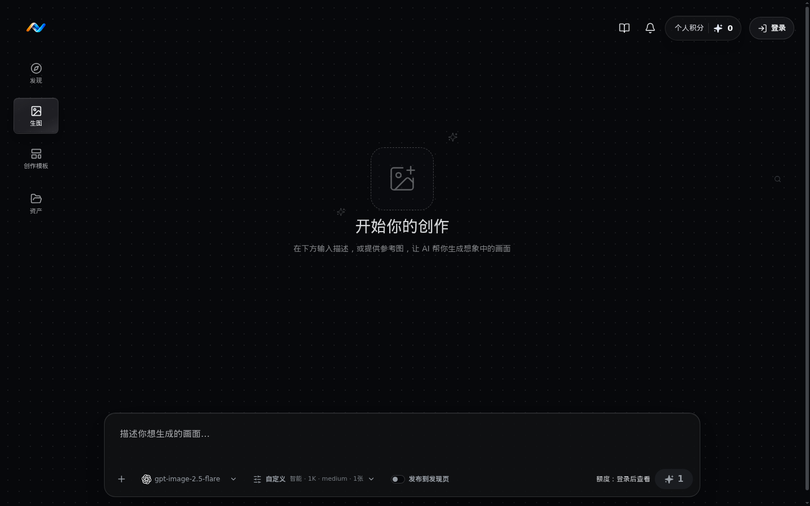
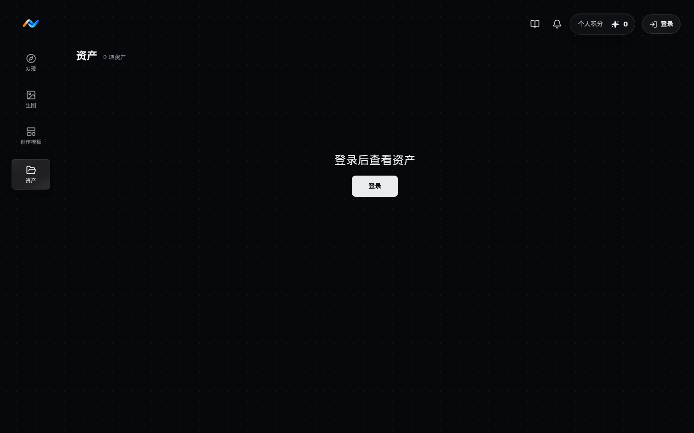

# Nebulens

安静、克制的 AI 图像生成工作台，将灵感输入、图片生成、结果回看和资产管理放在同一个创作空间。

提示词生图 · 参考图生图 · 资产历史 · 公开画廊 · 用户额度 · 管理员控制台

## 界面预览

以下截图来自当前 `dev` 工作树的实际页面，分辨率为 1440 × 900。

| 发现页                               | 生图工作区                                   | 资产页                                  |
| ------------------------------------ | -------------------------------------------- | --------------------------------------- |
|  |  |  |

## 功能

- **提示词生图**：支持模型、画质、分辨率、比例、数量和公开状态配置。
- **参考图生图**：最多上传 14 张参考图，支持复用历史参考图。
- **多模型接入**：支持 `gpt-image-2`、`gpt-image-2.5-flare` 和 `gpt-image-2.5-sunburst`。
- **生成会话**：保留成功、失败和进行中任务，按创建时间恢复结果顺序。
- **资产历史**：按日期、模型、可见性和收藏状态筛选，支持预览、编辑、下载和删除。
- **公开画廊**：通过公开开关控制作品是否进入发现页。
- **账号体系**：Better Auth 用户名/密码登录，可选 Google OAuth。
- **用户额度**：管理员可创建用户、设置永久额度和发放签到奖励。
- **OpenAI-compatible API**：提供 `/v1/images/generations` 入口。

## 技术栈

| 层         | 技术                                             |
| ---------- | ------------------------------------------------ |
| Frontend   | React 19, React Router, TypeScript, Vite, Vitest |
| UI         | Tailwind CSS 4, Radix UI, Motion, Lucide         |
| Backend    | Node.js, Express, TypeScript, Better Auth        |
| Data       | SQLite, Drizzle ORM, better-sqlite3              |
| Storage    | 本地上传目录、本地输出目录、Docker volumes       |
| Deployment | Docker Compose, nginx                            |

## 快速启动

需要 Node.js 22+、Docker 和 Docker Compose。

### 1. 配置环境变量

```bash
cp .env.docker.example .env
```

至少填写以下变量：

```env
IMAGE_API_BASE_URL=https://api.example.com
IMAGE_API_KEY=replace-me
USER_API_KEY_ENCRYPTION_KEY=replace-with-a-base64-encoded-32-byte-key
OPENAI_COMPAT_API_KEY=replace-me
BETTER_AUTH_SECRET=replace-with-a-random-secret
APP_VERSION=0.0.0
```

生成用户 Key 加密主密钥：

```bash
openssl rand -base64 32
```

本地访问配置通常保持为：

```env
FRONTEND_PORT=5173
FRONTEND_ORIGIN=http://localhost:5173
BETTER_AUTH_URL=http://localhost:5173
VITE_API_BASE_URL=
```

### 2. 启动

```bash
docker compose up -d --build
```

打开 <http://localhost:5173>。

```bash
docker compose ps
docker compose logs -f backend frontend
```

停止服务但保留数据：

```bash
docker compose down
```

同时删除数据库、参考图和生成结果：

```bash
docker compose down -v
```

### 3. 可选配置

登录用户的 2K/4K 请求可以使用独立上游：

```env
HIGH_RES_IMAGE_API_BASE_URL=
HIGH_RES_IMAGE_API_KEY=
HIGH_RES_IMAGE_MODEL=
```

如需 Google 登录，必须同时填写 `GOOGLE_CLIENT_ID` 和 `GOOGLE_CLIENT_SECRET`。本地回调地址为：

```text
http://localhost:5173/api/auth/callback/google
```

生产环境请使用 HTTPS 域名，并将 `FRONTEND_ORIGIN` 和 `BETTER_AUTH_URL` 统一设置为同一个 HTTPS origin。

## 本地开发

```bash
npm --prefix backend install
npm --prefix frontend install
cp backend/.env.example backend/.env
cp frontend/.env.example frontend/.env
```

分别启动后端和前端：

```bash
npm --prefix backend run dev
npm --prefix frontend run dev
```

默认地址：

```text
Frontend: http://localhost:5173
Backend:  http://localhost:3000
```

如果上游生图服务在另一个 Docker 网络中：

```bash
PROVIDER_NETWORK=your-provider-network docker compose -f docker-compose.yml -f docker-compose.provider.yml up -d --build
```

## 路由与 API

### 页面路由

| 路径           | 用途                         |
| -------------- | ---------------------------- |
| `/`            | 发现页、提示词输入和公开画廊 |
| `/generate`    | 生图工作区和当前会话结果     |
| `/templates`   | 创作模板                     |
| `/history`     | 个人资产历史                 |
| `/admin/users` | 管理员用户与额度管理         |

### API 入口

| 方法     | 路径                            | 用途                                                             |
| -------- | ------------------------------- | ---------------------------------------------------------------- |
| `GET`    | `/api/health/live`              | 进程存活检查                                                     |
| `GET`    | `/api/health/ready`             | 数据库与存储就绪检查                                             |
| `POST`   | `/api/images/generate`          | 标准生图                                                         |
| `POST`   | `/api/images/generate/high-res` | 2K/4K 生图                                                       |
| `GET`    | `/api/history`                  | 当前用户历史记录                                                 |
| `GET`    | `/api/settings/image-api-key`   | 当前用户 Key 状态                                                |
| `PUT`    | `/api/settings/image-api-key`   | 保存当前用户 Key                                                 |
| `DELETE` | `/api/settings/image-api-key`   | 删除当前用户 Key                                                 |
| `GET`    | `/api/auth/me`                  | 当前用户资料与权限                                               |
| `GET`    | `/api/admin/users`              | 管理员读取用户列表                                               |
| `POST`   | `/api/admin/users`              | 管理员创建用户                                                   |
| `PATCH`  | `/api/admin/users/:id/quota`    | 设置用户额度                                                     |
| `DELETE` | `/api/admin/users/:id`          | 删除普通用户                                                     |
| `POST`   | `/v1/images/generations`        | OpenAI-compatible 生图接口                                       |
| `POST`   | `/v1/images/edits`              | OpenAI-compatible 参考图生图（`image` 或 `image[]`，最多 14 张） |

## 配置参考

| 变量                          | 必需 | 说明                                                   |
| ----------------------------- | ---- | ------------------------------------------------------ |
| `IMAGE_API_BASE_URL`          | 是   | 标准图像生成上游                                       |
| `IMAGE_API_KEY`               | 是   | 标准图像生成密钥                                       |
| `USER_API_KEY_ENCRYPTION_KEY` | 是   | AES-256-GCM 用户 Key 加密主密钥                        |
| `OPENAI_COMPAT_API_KEY`       | 是   | OpenAI-compatible API 调用密钥                         |
| `BETTER_AUTH_SECRET`          | 是   | 会话签名密钥                                           |
| `APP_VERSION`                 | 是   | 健康检查返回的版本号，填部署的标签或提交               |
| `IMAGE_MODEL`                 | 否   | 后端默认模型，默认 `gpt-image-2`                       |
| `HIGH_RES_IMAGE_MODEL`        | 否   | 2K/4K 默认模型                                         |
| `IMAGE_API_TIMEOUT_MS`        | 否   | 生图请求超时，默认 300000ms                            |
| `TEXT_PROMPT_STRUCTURING`     | 否   | 为引号文字追加逐字清单，默认 `true`                    |
| `VISION_API_KEY`              | 否   | 视觉模型密钥，与 `VISION_MODEL` 同时配置才启用作品分析 |
| `VISION_MODEL`                | 否   | 视觉模型名，用于打标签、判断用途和核对文字             |
| `VISION_API_BASE_URL`         | 否   | 视觉模型接口地址，默认同 `IMAGE_API_BASE_URL`          |
| `UPLOAD_MAX_BYTES`            | 否   | 参考图上传上限，默认 10MiB                             |
| `DAILY_CHECK_IN_REWARD`       | 否   | 每日签到发放的额度，默认 5，7 天内有效                 |
| `SEED_DEFAULT_ADMIN`          | 否   | 是否创建本地演示管理员，生产环境保持 `false`           |
| `GOOGLE_CLIENT_ID`            | 否   | Google OAuth Client ID                                 |
| `GOOGLE_CLIENT_SECRET`        | 否   | Google OAuth Client Secret                             |

## 数据与备份

Docker Compose 使用以下持久化 volume：

| Volume                     | 内容           |
| -------------------------- | -------------- |
| `nebulens_backend-data`    | SQLite 数据库  |
| `nebulens_backend-uploads` | 参考图上传文件 |
| `nebulens_backend-outputs` | 生成结果文件   |

从旧版本升级的主机上可能还留有 `bellpicture_*` 数据卷，首次启动新版前需按 `docker-compose.yml` 末尾的说明迁移。

备份前先执行 SQLite checkpoint，再同时备份数据库卷、上传卷和输出卷：

```bash
docker compose exec backend node -e "const Database=require('better-sqlite3'); const db=new Database('/app/data/app.sqlite'); db.pragma('wal_checkpoint(TRUNCATE)'); db.close()"
docker run --rm -v nebulens_backend-data:/source -v "$PWD/backups:/backup" alpine tar czf /backup/backend-data.tgz -C /source .
docker run --rm -v nebulens_backend-uploads:/source -v "$PWD/backups:/backup" alpine tar czf /backup/backend-uploads.tgz -C /source .
docker run --rm -v nebulens_backend-outputs:/source -v "$PWD/backups:/backup" alpine tar czf /backup/backend-outputs.tgz -C /source .
```

生产环境只公开前端 nginx 或上层反向代理，后端 `3000` 端口保持在容器网络内。`USER_API_KEY_ENCRYPTION_KEY` 必须独立备份，丢失后已保存的用户 Key 无法解密。

## 质量检查

```bash
npm --prefix backend run format:check
npm --prefix backend run lint
npm --prefix backend run typecheck
npm --prefix backend run test
npm --prefix backend run build

npm --prefix frontend run format:check
npm --prefix frontend run lint
npm --prefix frontend run typecheck
npm --prefix frontend run test
npm --prefix frontend run build
```

常用数据库与存储脚本：

```bash
npm --prefix backend run db:generate
npm --prefix backend run db:migrate
npm --prefix backend run storage:report-orphans
```

## GitHub About

建议描述：

```text
安静克制的 AI 图像生成工作台，支持提示词/参考图生图、本地资产历史、用户额度和管理员账号管理。
```

建议 topics：

```text
react, express, typescript, ai-image-generation, better-auth, sqlite, drizzle, vite
```
